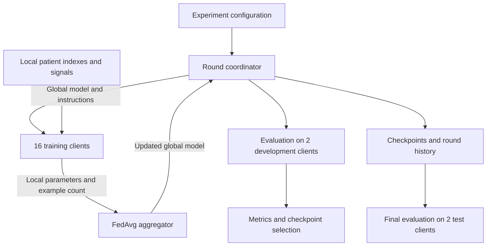

# FL architecture — FedAvg in C#

The executable local simulation is now in [`implementation/`](../implementation/README.md): MobileNetV1 1D alpha 1.00, three training clients randomly selected once from a pool of 16 and fixed across all rounds and seeds, one random dev patient and one preselected test patient per round, 25 local epochs per round, 10 rounds, and three seeds, with checkpoint selection by development S/V PR-AUC. The CPU implementation uses equivalent vectorized convolution operations, all original beats of selected clients/patients, and deferred test inference after all training and tuning choices are locked. Its configuration and documented BatchNorm policy supersede the initial baseline choices below. No experiment has been trained by adding this implementation.

The remainder of this document records the initial design proposal. ECG preparation and analysis live in `src/Aih.Ecg/`; distributed transport remains planned.

## Components



| Component | Responsibility |
| --- | --- |
| Coordinator | Initialize the model, select clients, distribute the global version, and control rounds |
| Client | Read its own index, load beats in batches, and train locally |
| Model | Define identical architecture, parameter schema, and class order across clients |
| Aggregator | Validate updates and calculate weighted parameter averages |
| Evaluator | Calculate loss, confusion matrices, and per-class/patient metrics |
| Storage | Save configuration, checkpoints, participants, aggregation weights, and results |
| Transport | Start with local calls; later support clients in separate processes or machines |

Existing C# CSV/NPZ readers will be reused. TorchSharp is the proposed local training engine; its FL integration still needs implementation and validation. FL coordination will be written in C#. The tensor engine does not need to be reimplemented.

## Data and model

- Training: `client_00` through `client_15`, with indexes in `data/clients/`.
- Development: `client_16` and `client_17`, with indexes in `data/evaluation_clients/`.
- Test: `client_18` and `client_19`, also in `data/evaluation_clients/`.
- Patient/client assignments and partitions come from `data/preparation_config.json`, without resampling the patient split.
- Proposed input: one normalized beat, tensor shape `[batch, 1, 500]`.
- Proposed initial output: four logits, ordered `N=0`, `S=1`, `V=2`, `Q=3`. Q retains its unclassifiable meaning.

The initial FL baseline proposes a simple 1D CNN without BatchNorm and unweighted cross-entropy. Its exact architecture will be finalized before FL training is implemented. Changes to classes, sampling, or loss weights must be separate, identified experiments. Test patients are excluded from hyperparameter and checkpoint selection.

## FedAvg round

1. The server publishes global parameters `w_t` and the round identifier.
2. It selects the 16 training clients; initially every training client participates in every round.
3. Each client loads `w_t`, creates a new local SGD optimizer, and trains for the configured local epochs.
4. Each client returns its final parameters, received version, and `n_k`: the number of distinct local examples used in that round.
5. The server validates responses and aggregates parameters.
6. It evaluates the global model on development clients and saves the round checkpoint and, when appropriate, the best checkpoint.
7. At the end, it evaluates the selected checkpoint once on the test clients.

For the accepted-update set `S_t`:

```text
N_t     = sum(n_k), for k in S_t
w_(t+1) = sum((n_k / N_t) * w_(t+1,k)), for k in S_t
```

Weights are proportional to distinct examples, not batches, epochs, or optimizer steps. In the baseline, each epoch traverses every local example without replacement and keeps the final partial batch. Therefore, `n_k` is the dataset size even across multiple epochs. Optimizer states are not aggregated, and development/test clients receive no aggregation weight.

Parameter names, shapes, and types must match across clients. Initially, only floating-point trainable parameters will be aggregated; models with additional buffers require an explicit policy. Weighted sums may use higher-precision accumulators before conversion back to the model's data type.

Algorithm reference: [McMahan et al., 2017 — Communication-Efficient Learning of Deep Networks from Decentralized Data](https://proceedings.mlr.press/v54/mcmahan17a.html).

## Execution, failures, and evaluation

The first version executes clients sequentially on one machine, with independent client models and optimizers. This is a simulation; physical separation across machines is a later stage. The training contract does not transmit ECG signals to the coordinator.

A round completes only after all 16 valid updates arrive. Client failures, non-finite parameters, duplicate responses, or incorrect versions abort the round without modifying the last completed global checkpoint. Partial participation requires a separate policy. Data must be read sequentially/in batches without loading millions of files into memory.

Evaluation sums patient confusion matrices within each split and derives global metrics from the combined counts. Also report per-patient metrics, per-class precision/recall/F1, four-class macro-F1, and accuracy. For zero denominators in this proposed FL baseline, use zero and report class support. Global loss is weighted by example count; do not take an unweighted average of client F1 scores. Select the best checkpoint by development macro-F1, retaining the earliest checkpoint on ties.

Publish checkpoints atomically from temporary files, including the round, parameters, configuration, model schema, seeds, and participants. Recovery starts after the last completed round; random states must be deterministic by round/client. Future distributed transport must authenticate clients and bind identities to their indexes. FedAvg alone does not provide differential privacy or secure aggregation.

## Planned organization

```text
src/
  Aih.Ecg/             # Existing signal reading and preparation
  Aih.Fl.Core/         # Contracts, configuration, and FedAvg
  Aih.Fl.Training/     # Model, batches, local training/evaluation
  Aih.Fl.Simulation/   # Coordinator and local execution
artifacts/fl/<runId>/  # Configuration, rounds, metrics, checkpoints
```

These new FL source directories have not been created yet. Contracts are described in [contracts.md](contracts.md). [fedavg.example.json](fedavg.example.json) is a proposed configuration and is not currently executable.

Implementation order: contracts and aggregation with numerical tests → single-client model/training → one-round simulation → multiple rounds with evaluation and checkpoints → transport across processes/machines.
